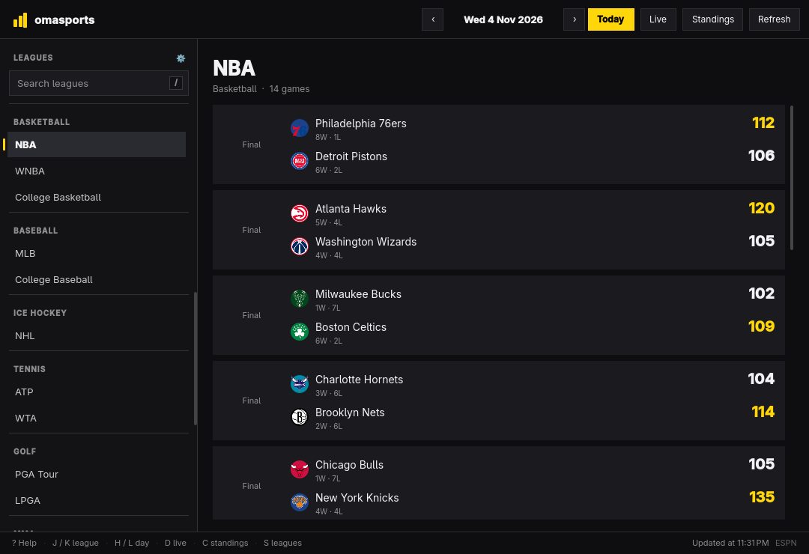
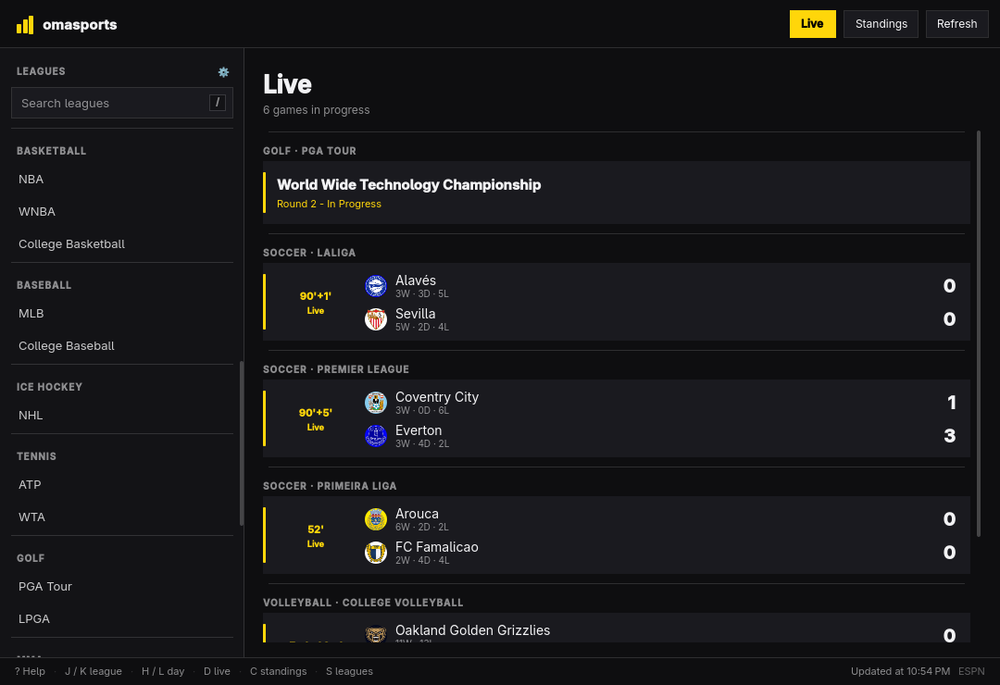
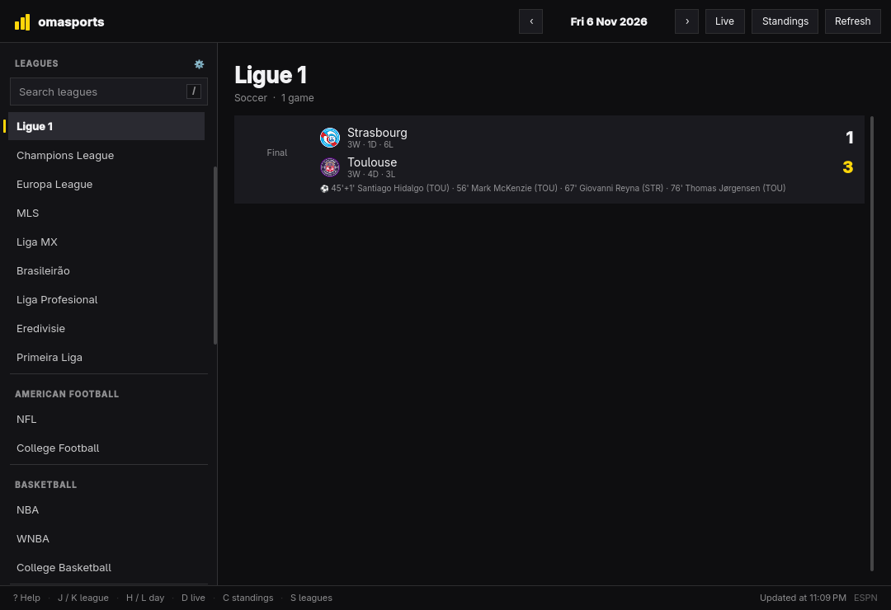
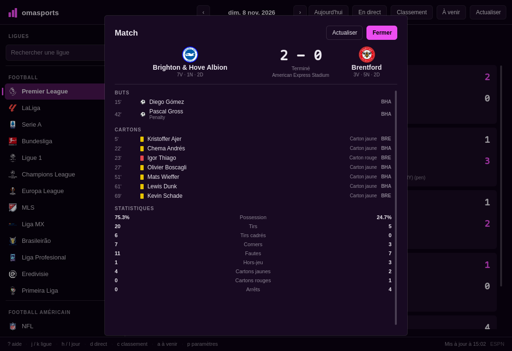
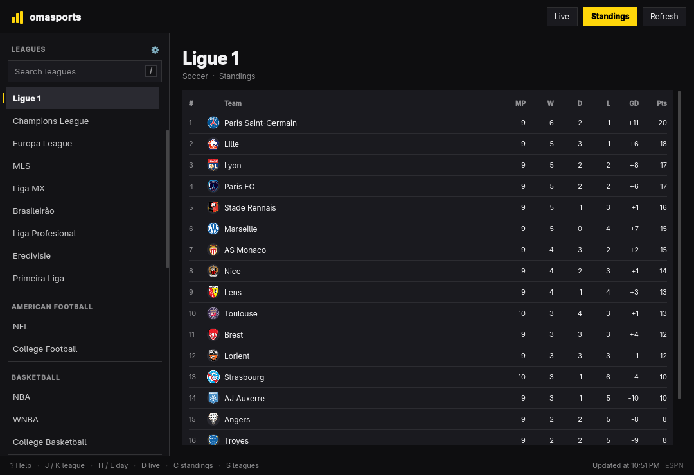

[English](README.md) | Français

# omasports

**Version 1.0.0** — Scores et calendriers de tous les sports, dans une seule fenêtre, au clavier.
Application de bureau Qt Quick native pour Linux qui suit le thème et la langue d'Omarchy.



## Ce que fait l'application

- Scores, calendriers et résultats finaux pour 34 compétitions : football,
  football américain, basketball, baseball, hockey, tennis, golf, MMA, sports
  automobiles, rugby, cricket, volley-ball et football australien.
- Une vue **Direct** (`d`) parcourt chaque ligue suivie et ne conserve que les
  matchs en cours, avec indication du sport et de la ligue.

  

- Buteurs affichés sous le score, et fiche de match au clic avec buts, passes
  décisives, cartons et statistiques clés.

  
  

- Une vue **Classement** (`c`) affiche le tableau de la ligue sélectionnée, avec
  positions, matchs joués, victoires, nuls, défaites, différence de buts et
  points, regroupés par conférence ou par poule lorsque le flux les sépare.

  

- Une vue **À venir** (`a`) liste les prochains matchs de la ligue sélectionnée.
- Un menu **Paramètres** (`p`) permet de choisir quelles ligues apparaissent dans
  la barre latérale et dans la vue Direct, de régler la taille du texte et
  d'activer ou non les logos des ligues dans la barre latérale et l'en-tête.
- Un bouton « Aujourd'hui » et une navigation jour par jour, pour retrouver les
  résultats d'hier en une touche.
- Recherche dans toutes les ligues, dans la langue du bureau.
- Les matchs en cours sont actualisés toutes les 30 secondes ; la vue Direct se
  réanalyse toutes les minutes. L'en-tête indique combien de matchs sont en
  direct.
- Suit en direct la palette Omarchy (sombre ou claire), la couleur d'accent,
  l'arrondi des fenêtres et la langue.

## Installation

Trois méthodes d'installation. Choisissez celle qui correspond à votre
configuration.

### (a) Archive de release

Téléchargez `omasports-<sha>-linux-<arch>.tar.gz` et son fichier `.sha256`
depuis la page [Releases](../../releases) (`x86_64` ou `arm64`). Les archives
sont produites par la CI et publiées sur la page Releases — n'utilisez jamais un
build local comme archive distribuable.

```sh
sha256sum -c omasports-<sha>-linux-<arch>.tar.gz.sha256
tar -xzf omasports-<sha>-linux-<arch>.tar.gz
cd omasports-<sha>-linux-<arch>
install -Dm755 omasports ~/.local/bin/omasports
install -Dm644 omasports.svg ~/.local/share/icons/hicolor/scalable/apps/omasports.svg
install -Dm644 omasports.desktop ~/.local/share/applications/omasports.desktop
```

Ajustez `Exec=` dans le fichier `.desktop` si le binaire se trouve ailleurs que
dans `~/.local/bin/omasports`.

### (b) Paquet Arch (PKGBUILD)

Construisez et installez l'application empaquetée depuis le dépôt en utilisant
`pkgbuild/PKGBUILD` :

```sh
cd pkgbuild
makepkg -si
```

Ou utilisez le script d'aide, qui construit, empaquette et installe via `pkexec`
pour que omasports apparaisse dans le lanceur d'Omarchy :

```sh
bin/install
```

### (c) Build depuis les sources

Construisez depuis une copie du dépôt et lancez ou liez le binaire vous-même :

```sh
bin/build
./build/omasports
```

Pour le rendre disponible depuis votre lanceur sans installer de paquet :

```sh
ln -sf "$PWD/build/omasports" ~/.local/bin/omasports
install -Dm644 pkgbuild/omasports.svg \
  ~/.local/share/icons/hicolor/scalable/apps/omasports.svg
install -Dm644 pkgbuild/omasports.desktop \
  ~/.local/share/applications/omasports.desktop
```

## Source des données

Les scores, calendriers, classements et détails des matchs proviennent de l'API
publique de tableau de bord d'ESPN. Aucune clé ni aucun compte n'est requis.

- **Flux non officiel** : l'API n'est pas un produit documenté et supporté et
  n'offre aucune garantie de service (SLA). Un match peut être manquant, avoir
  une minute de retard ou changer de forme sans préavis.
- **Gestion de la saison** : omasports envoie explicitement la saison lors des
  requêtes afin que les résultats correspondent à l'année de compétition
  attendue ; lorsque la saison ne peut pas être déterminée de manière fiable,
  l'interface signale une saison incertaine.
- **Affiches fantômes** : les affiches dupliquées ou fantômes renvoyées par le
  flux sont dédoublonnées avant l'affichage.
- **Logos** : les drapeaux nationaux ne sont jamais utilisés comme logos de
  clubs ; seules des marques d'équipe ou de ligue appropriées sont affichées
  lorsque les logos sont activés.
- **Disponibilité** : lorsque le flux ne répond pas, omasports signale une
  erreur réseau et garde l'interface utilisable ; il n'y a pas de cache hors
  ligne persistant.

## Configuration

Ouvrez les **Paramètres** avec `p`.

- **Taille du texte** : cinq niveaux, appliqués à l'ensemble de l'interface.
- **Logos des ligues** : options pour afficher les logos dans la barre latérale
  et dans l'en-tête.
- **Ligues activées** : choisissez quelles ligues apparaissent dans la barre
  latérale et sont analysées par la vue Direct.

Les réglages sont enregistrés dans les paramètres Qt de l'application pour votre
compte utilisateur (via `QSettings` pour l'application omasports) et sont
conservés d'un lancement à l'autre.

## Dépannage

- **Classement vide** : la ligue sélectionnée peut ne pas fournir de classement
  pour la saison en cours, ou le flux n'a renvoyé aucune ligne. Essayez
  d'actualiser, de changer de date ou de contexte de saison, ou de consulter une
  autre ligue.
- **Saison incertaine** : la saison n'a pas pu être déterminée de manière
  fiable à partir des données. Les scores peuvent tout de même être affichés,
  mais le contexte propre à la saison est à considérer avec prudence.
- **Fiche de match indisponible** : les détails d'un match (buteurs, cartons,
  statistiques) ne sont pas toujours publiés pour chaque compétition ou
  événement. Une fiche peut être absente ou incomplète même si le score est
  connu.
- **Erreur réseau** : le flux ESPN n'a pas pu être joint ou n'a pas répondu à
  temps. Vérifiez votre connexion et appuyez sur `espace` ou `r` pour
  actualiser. L'application ne conserve pas de cache hors ligne persistant.
- **Un raccourci ne répond pas pendant la recherche** : lorsque le champ de
  recherche de ligue a le focus, la saisie de texte est envoyée à la recherche.
  Appuyez sur `esc` pour effacer ou fermer la recherche et rétablir les
  raccourcis normaux.

## Raccourcis

Les touches sont indiquées en minuscules ; les majuscules fonctionnent aussi.

| Touche | Action |
| --- | --- |
| `d` | Vue Direct : tous les matchs en cours |
| `c` | Classement de la ligue sélectionnée |
| `a` | Matchs à venir pour la ligue sélectionnée |
| Clic sur un match | Ouvrir sa fiche |
| `p` | Paramètres : ligues affichées, taille du texte, logos |
| `j` / `k`, `↓` / `↑` | Ligue suivante / précédente |
| `h` / `l`, `←` / `→` | Jour précédent / suivant |
| `t` | Retour à aujourd'hui |
| `espace`, `r` | Actualiser les scores |
| `/` | Rechercher des ligues |
| `?` | Afficher tous les raccourcis |
| `esc` | Fermer l'aide ou les paramètres, ou effacer la recherche |
| `q` | Quitter |

## Langues

Toutes les chaînes sont traduites via le registre de langues d'Omarchy ;
l'anglais et le français sont fournis avec l'application. Les dates, heures,
nombres, pluriels et abréviations de bilan suivent la même locale, et la fenêtre
se met en miroir pour les langues écrites de droite à gauche. Pour en ajouter
une, copiez `src/i18n/en.json` ou `src/i18n/fr.json`, traduisez les valeurs et
ajoutez le fichier à `src/resources.qrc`.

## Développement

```sh
bin/build        # qmake6 + make dans build/omasports
bin/test         # suite de tests Qt, hors écran
./check.sh       # shellcheck (bin/*, check.sh), compilation, puis tests hors écran
bin/clean        # supprime build/ et dist/
```

Après un build local, lancez `bin/clean` pour ne rien laisser en local : les
archives distribuables doivent provenir de la CI, pas d'une machine locale.

Il n'y a volontairement pas de build cross-architecture local : les archives
x86_64 et arm64 sont produites par le workflow de CI et rien n'est construit en
dehors de l'hôte natif. Définissez `BUILD_DIR` pour envoyer un `bin/build`
normal ailleurs que dans `build/`.

L'exécution des tests nécessite Qt Test et Qt Quick Test (module QML `QtTest` et
`libQt6QuickTest`, fournis par `qt6-declarative`). Les tests de géométrie
chargent des composants QML hors écran (`QT_QPA_PLATFORM=offscreen`) et
n'effectuent aucun appel réseau.

`check.sh` agrège les contrôles (code de sortie non nul si une étape échoue) et
sert de point d'entrée de validation avant commit.

### Build sur Debian/Ubuntu

La CI construit et teste sur Ubuntu 24.04 avec les paquets ci-dessous (`qmake6`,
`make` et `g++` sont requis par `bin/build`) :

```sh
sudo apt-get install --no-install-recommends \
  build-essential pkg-config shellcheck \
  qt6-base-dev qt6-declarative-dev qt6-declarative-dev-tools \
  qt6-wayland qt6-wayland-dev qt6-tools-dev \
  qml6-module-qttest qml6-module-qtquick qml6-module-qtquick-window \
  qml6-module-qtquick-controls qml6-module-qtquick-templates \
  qml6-module-qtquick-layouts \
  qml6-module-qtqml qml6-module-qtqml-models qml6-module-qtqml-workerscript \
  libqt6quicktest6
```

Les paquets `qml6-module-*` fournissent les modules QML chargés à l'exécution
par les tests et les composants Qt Quick. `libqt6quicktest6` fournit le runtime
Quick Test lié par `QT += quicktest`.

Ajouter une ligue se fait en une ligne dans la table `catalog` de
`src/backend.cpp`, en utilisant les slugs de sport et de ligue d'ESPN. Son
tableau de bord se trouve à
`https://site.api.espn.com/apis/site/v2/sports/<sport>/<league>/scoreboard`.

## Structure

```text
bin/build  bin/test  bin/install  bin/clean
src/main.cpp            initialisation de l'application
src/backend.{h,cpp}     catalogue, scores, scan direct, filtre de ligues, réglages
src/theme.{h,cpp}       palette Omarchy et arrondi Hyprland
src/translator.{h,cpp}  langue Omarchy, en direct
src/Main.qml            fenêtre, en-tête, clavier, états
src/LeagueSidebar.qml   liste des ligues, sections de sport, recherche
src/EventCard.qml       un match ou événement
src/StandingsView.qml   le classement de la ligue
src/UpcomingView.qml    matchs à venir
src/MatchOverlay.qml    la fiche de match
src/TeamBadge.qml       écusson avec repli sur l'abréviation
src/ActionButton.qml    bouton plat suivant le thème
src/LogoMark.qml        marque de la barre de score, dans la couleur d'accent
src/SettingsOverlay.qml liste des réglages (ligues, taille du texte, logos)
src/HelpOverlay.qml     la fiche des raccourcis
tests/                  tests pour backend, theme, translator
pkgbuild/               PKGBUILD, entrée desktop, icône
```

## Crédits

Le suivi du thème et le traducteur s'inspirent d'[Omacut](https://github.com/omacom-io/omacut)
(MIT, David Heinemeier Hansson). Les scores sont fournis par l'API publique
d'ESPN.

## Licence

MIT.
