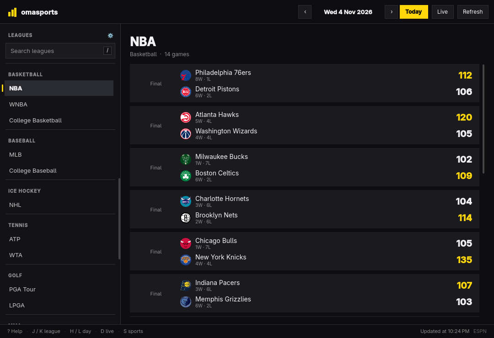
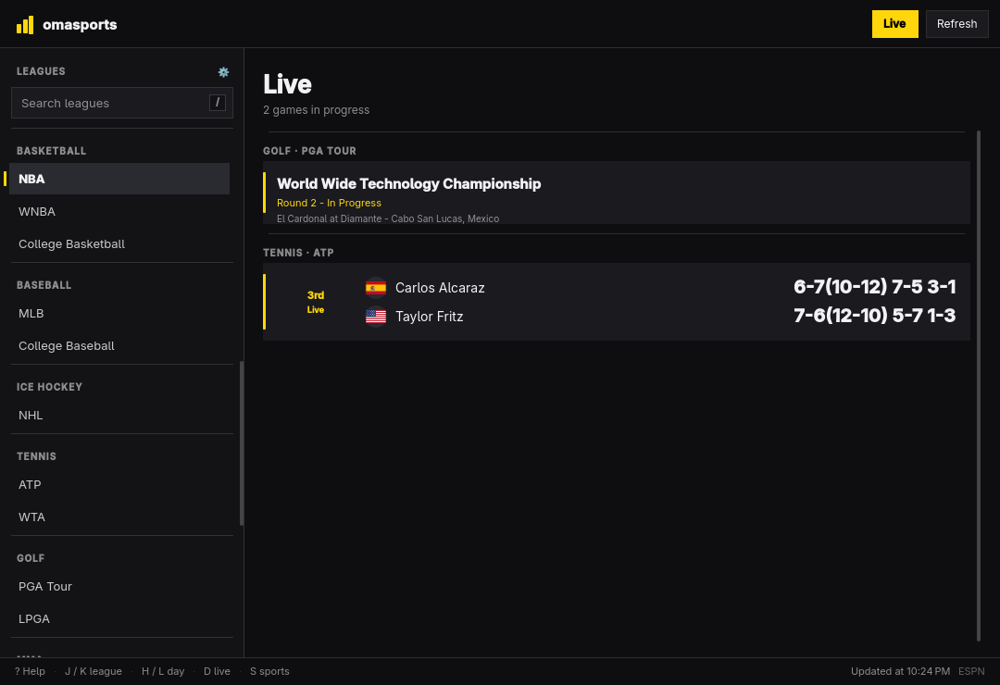

# omasports

Live scores and fixtures for every sport, in one window, from the keyboard.



## What it does

- Scores, schedules, and finals for 33 competitions across soccer, American
  football, basketball, baseball, hockey, tennis, golf, MMA, racing, rugby,
  cricket, volleyball, and Australian football.
- A **Live** view (`D`) scans every league at once and keeps only the games in
  progress, with each sport and league called out.

  

- A **Sports** menu (`S`) chooses which sports appear in the sidebar and in the
  live view; the choice is remembered across launches.
- A "Today" button and day-by-day navigation, so yesterday's results are one
  key away.
- Season records read like `3V · 1N · 5D` in French and `3W · 1D · 5L` in
  English, instead of ESPN's bare `3-1-5`.
- Games in progress refresh every 30 seconds; the live view rescans every
  minute. The header shows how many games are live.
- Search across every league, in the language of the desktop.
- Follows the Omarchy palette (dark or light), accent, window rounding, and
  language live.

Scores come from ESPN's public scoreboard API. No key, no account. The feed is
unofficial, so a rare game can be missing or lag a minute behind.

## Install

```sh
bin/install
```

That builds the app, packages it with `makepkg`, and installs it through
`pkexec`, so it shows up in the Omarchy launcher.

To run from the checkout without installing, build it and point your own
launcher at the binary:

```sh
bin/build
ln -sf "$PWD/build/omasports" ~/.local/bin/omasports
install -Dm644 pkgbuild/omasports.svg \
  ~/.local/share/icons/hicolor/scalable/apps/omasports.svg
install -Dm644 pkgbuild/omasports.desktop \
  ~/.local/share/applications/omasports.desktop
```

Adjust `Exec=` in the `.desktop` file if the binary lives somewhere other than
`~/.local/bin/omasports`.

## Keys

| Key | Action |
| --- | --- |
| `D` | Live view: every game in progress |
| `S` | Choose which sports to show |
| `J` / `K`, `↓` / `↑` | Next / previous league |
| `H` / `L`, `←` / `→` | Previous / next day |
| `T` | Back to today |
| `Space`, `R` | Refresh scores |
| `/` | Search leagues |
| `?` | Show every shortcut |
| `Esc` | Close the help or sports menu, or clear the search |
| `Q` | Quit |

## Languages

Every string is translated through Omarchy's language registry; French ships
with the app. Dates, times, numbers, plurals, and the record abbreviations
follow the same locale, and the window mirrors for right-to-left languages. To
add one, copy `src/i18n/fr.json`, translate the values, and add the file to
`src/resources.qrc`.

## Development

```sh
bin/build   # qmake6 + make into build/omasports
bin/test    # Qt Test suite, offscreen
```

The scoreboard and live parsers, the league catalog, sports filtering,
persistence, and day navigation are covered by tests that never touch the
network: `Backend` takes an offline flag for exactly that.

Adding a league is one line in the `catalog` table in `src/backend.cpp`, using
ESPN's sport and league slugs. Its scoreboard lives at
`https://site.api.espn.com/apis/site/v2/sports/<sport>/<league>/scoreboard`.

## Layout

```text
bin/build  bin/test  bin/install
src/main.cpp            application setup
src/backend.{h,cpp}     catalog, scores, live scan, sports filter, settings
src/theme.{h,cpp}       Omarchy palette and Hyprland rounding
src/translator.{h,cpp}  Omarchy language, live
src/Main.qml            window, header, keyboard, states
src/LeagueSidebar.qml   league list, sport sections, search
src/EventCard.qml       one game or event
src/TeamBadge.qml       crest with an abbreviation fallback
src/ActionButton.qml    flat theme-following button
src/LogoMark.qml        the score-bar mark, in the live accent
src/SettingsOverlay.qml the sports checklist
src/HelpOverlay.qml     the shortcut sheet
tests/                  tests for backend, theme, translator
pkgbuild/               PKGBUILD, desktop entry, icon
```

## Credits

The theme watcher and translator follow [Omacut](https://github.com/omacom-io/omacut)
(MIT, David Heinemeier Hansson). Scores are served by ESPN's public API.

## License

MIT.
